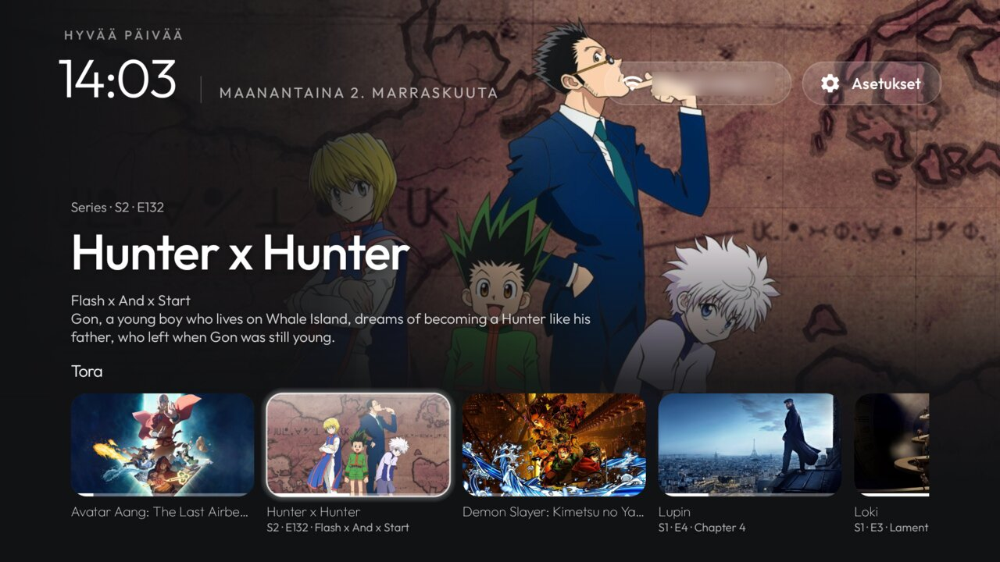

# Continue watching in the top shelf

A fork of [cleanyourtv](https://github.com/Gathin23/cleanyourtv)'s launcher, built and tested on a Google TV Streamer
(`kirkwood`, Google TV 14, `UTTK.260317.003`). The code is on the `tora-shelf` branch.

When a dock app has focus, its rows from Android TV's Continue watching (the Watch Next table) show as cards under the
app's name in the top shelf: artwork, title, season and episode, and a progress bar. An app with no rows keeps the
plain shelf.

Up from the dock tile moves onto the cards and Home turns into a browse view: the dock and grid slide off the bottom,
the cards drop to the bottom edge, and the focused title's artwork fills the screen behind its type, season and
episode, title, episode title and description. Left and Right move between cards (the backdrop follows once focus
settles), OK opens the row's own link into the app, and Down or Back returns to the dock.

## What it changes

- A new switch, `continue_watching` (`config.xml`, or a theme's `config.json`), on in this fork. `false` gives the
  upstream shelf back.
- `WatchNextShelf.java` reads the table, `ShelfImages.java` loads the artwork and `ContinueRow.java` is the card row;
  `MainActivity` binds the cards when the shelf shows a dock app, sends Up from a dock tile onto them and runs the
  browse view (`enterBrowse`, `exitBrowse`).
- The table is read when Home comes back and when it changes (a debounced content observer). No polling and no
  background service.
- Rows are filtered on the TV: no link, last watched more than 60 days ago, or 95% watched are left out; up to 8
  per app, newest first.

[Mehdi-Ks's fork](https://github.com/Mehdi-Ks/cleanyourtv/blob/my-tv/FORK.md) also shows Watch Next above the
dock; this one adds focusable cards with progress bars, the full-screen browse view and remembers the last card per
app.

## Permissions and network

- `READ_TV_LISTINGS`, to read the rows other apps publish (only rows they mark searchable; see
  [docs/watch-next.md](docs/watch-next.md)). It is a runtime permission, granted once over ADB:
  `adb shell pm grant com.gathin.tvhome android.permission.READ_TV_LISTINGS`. Without it the shelf stays plain.
- `INTERNET`, only to load the artwork the publishing apps give as `https` links, from each app's own image host
  (for example `image.tmdb.org`). Nothing else is fetched or sent.
- The release APK is 597 KB, over upstream's 576 KB limit.

## Build and install

As upstream (JDK 17, Android SDK 34): from `launcher/`, `./gradlew --no-daemon assembleRelease`, then
`adb install -r app/build/outputs/apk/release/app-release.apk` and the `pm grant` above. The application ID is
upstream's, so it installs over a build you signed with the same debug key and keeps your dock and settings.

Which apps fill the shelf depends on what they publish. On this TV, Tora fills it; YouTube publishes no
Watch Next rows.
